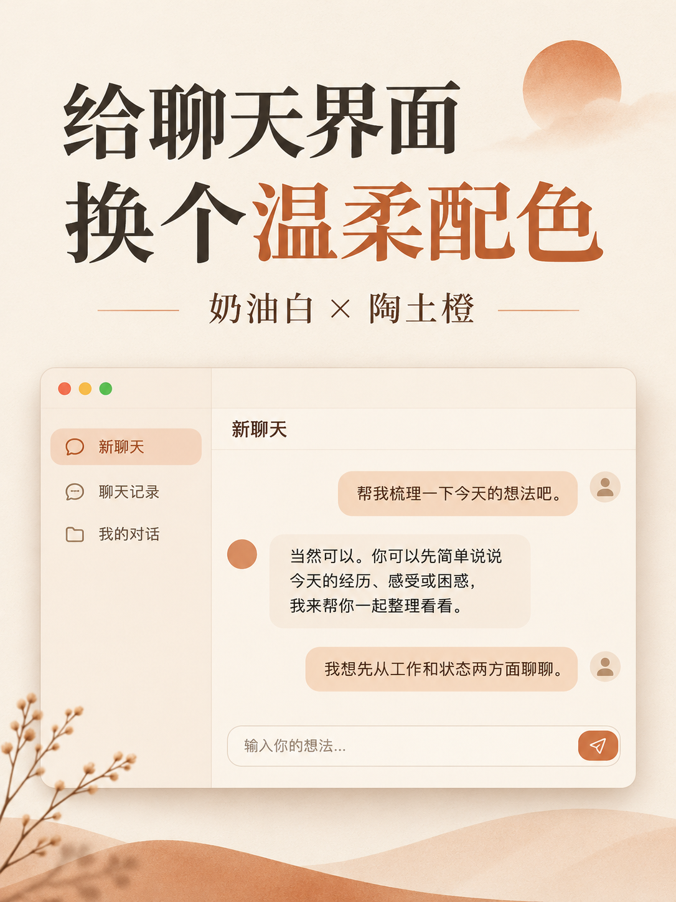

# 奶油白聊天主题

一套受 Claude 暖色界面启发的浅色主题：奶油白背景、深灰文字、陶土橙点缀和宋体风格的中文字体。

> 图片为宣传示意图，不是实际应用截图；具体界面与显示效果以应用版本和设备为准。本项目是独立的社区主题，与 Claude、Anthropic 或 OpenAI 无官方关联。

## 主题配置

打开 [theme.txt](theme.txt)，复制其中完整的一行（包含 `codex-theme-v1:` 前缀）。

1. 在支持 `codex-theme-v1` 的桌面应用中打开外观或主题设置。
2. 选择「导入主题」，粘贴完整配置并导入。
3. 选择浅色外观，查看效果。

这是主题配置，不是程序，无需执行代码。不同应用版本的入口名称和显示效果可能不同。主题依赖 `Songti SC` 字体；如果设备没有该字体，应用可能会使用其他字体。界面字体设置也可能影响按钮、侧边栏等文字。

## 手机端

目前尚未验证手机 ChatGPT 是否支持导入此主题格式。手机上可在应用设置中尝试调整浅色外观及可用的强调色，无法保证还原此主题。

## 配色

| 用途 | 色值 |
| --- | --- |
| 背景 | `#F5F3EC` |
| 文字 | `#302D29` |
| 强调色 | `#C96442` |

如果希望恢复原样，可以在应用的主题设置中选择默认主题或重置外观设置。
